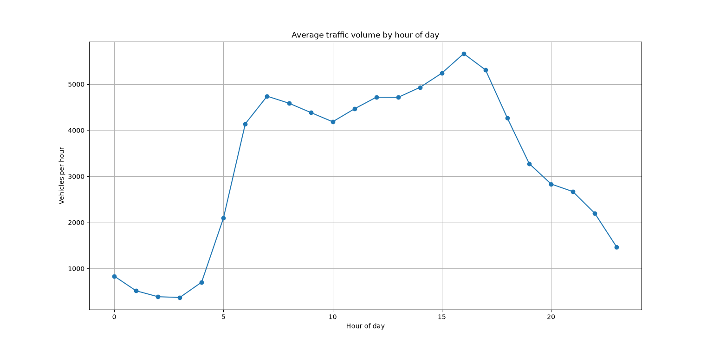

# Dhaka-Traffic-Project
Exploring hourly traffic patterns with Python and Pandas, starting with a public dataset and moving to original data from Gulshan-Banani, Dhaka.

## Question
What drives traffic volume at different times of day, and how does it compare with Dhaka?

## Stage 1: Public dataset
Metro Interstate Traffic Volume dataset (Dataset: [Metro Interstate Traffic Volume](https://archive.ics.uci.edu/dataset/492/metro+interstate+traffic+volume) (UCI Machine Learning Repository). Hourly westbound traffic on Interstate 94 near Minneapolis-St Paul, Minnesota, 2012-2018, with weather and holiday data. 48,204 records. Downloaded via a [Kaggle copy](https://www.kaggle.com/datasets/pooriamst/metro-interstate-traffic-volume).), 48,204 hourly records.

**Finding so far:** Traffic has a sharp morning peak around 7 AM and a broader, higher afternoon peak around 4 PM. The lowest point is around 3 AM.

## Stage 2 (planned)
Collect original traffic data in Gulshan-Banani, Dhaka, and compare the daily pattern with Stage 1.

## Tools
Python, Pandas, Matplotlib
